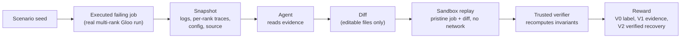

# Architecture

One page. For the research side see [`docs/README.md`](docs/README.md).

## Module map

| path | role |
|---|---|
| `traindoctor_env/` | Core environment, plain Python (no OpenEnv, Inspect or MLX). `scenario.py` (what to run, and the hidden truth), `snapshot.py` (run the failing job once and freeze it), `tools.py` (agent-facing tool surface), `bundle.py` / `tiera.py` (single-turn prompt and reward), `reexec.py` (replay a fix and recompute invariants), `verifiers.py` (V0, V1, V2), `oracle.py` (reference solver). |
| `jobs/` | The executable training job (`template/`), fault injection (`build.py`), the launcher and trusted data server, checkpoint manifest and resubmission logic, and the sandbox profile. |
| `rl/` | Prompt rendering, seed splits, SFT data generation and local training probes. |
| `modal_train/` | Modal (cloud) backend: SFT / GRPO / eval on GPUs and the network-less sandbox that runs the replays. Needs a Modal account. |
| `audit/` | Menu-leak audit: can the answer be read off the repair menu alone. |
| `scripts/` | Entry points: `quickstart.py`, `redteam_suite.py`, `analyze_test.py`, `audit_test_recount.py`, `make_figures.py`. |
| `tests/` | pytest suite (rules from the spec, not snapshots of output; snapshot tests are named `test_snapshot_*`). |
| `docs/`, `experiments/` | Write-ups and hash-checked evidence; see `docs/README.md`. |

## Data flow

The hidden truth (which fault was injected) lives only in the scenario and is never part of the snapshot the agent sees. The verifier runs outside the sandbox and reads only files copied out of it.
