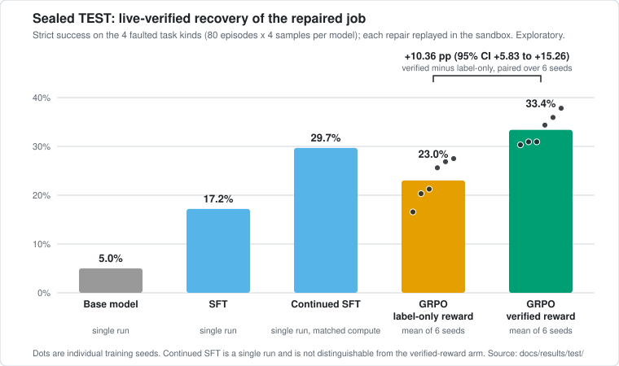
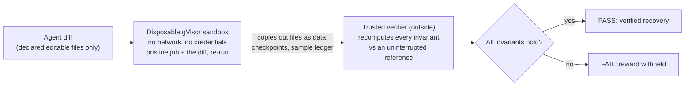

# TrainDoctor

**TrainDoctor: An executable RL environment for debugging and repairing distributed ML training failures.**

An AI agent is handed a multi-process training job that has just failed. It reads the logs and traces, proposes a code or config fix, and TrainDoctor checks whether training actually recovered with its computation intact, not just whether the program stopped crashing.

> **Research Preview v0.1.** Two task families, exploratory results, Apache-2.0. No new training algorithm is claimed.


## Why it matters

- **The failures are real.** Each task is a genuine multi-process PyTorch (Gloo) job that hangs, crashes or silently skips data. They are not canned logs.
- **"Exit code 0" is not a pass.** Every proposed fix is re-run in a disposable sandbox and graded on recovery invariants (which samples were trained on, restored state, rank agreement).
- **The reward was attacked before it was used.** A red team of fake repairs tried to fool the verifier before any model was trained against it.

## Results at a glance

**The verifier was not fooled.** 86 fake repairs, none accepted; the controls behave as they should.


**Training against it helped, modestly.** On a sealed, pre-registered test set (100 episodes, run once):



- Supervised fine-tuning (SFT) lifted strict verified success from 5.0% to 17.2% (+12.2 points, 95% CI [+6.9, +17.8]).
- Reinforcement learning (GRPO) with the verified reward beat the same training with a label-only reward by **+10.36 points** (CI [+5.83, +15.26]). The gain comes from better evidence grounding: the model cited the right evidence more often. Diagnosis accuracy and repair choice did not change (71.4% vs 71.5% of faulted samples picked the recovering repair).
- The verified-reward arm is **not distinguishable from compute-matched continued SFT**, which is a single run. Two task families, six paired seeds: treat everything here as exploratory. See [`docs/results/TEST_REPORT.md`](docs/results/TEST_REPORT.md) and the independent recount, [`AUDIT_RECOUNT.txt`](docs/results/test/AUDIT_RECOUNT.txt).

## How verification works



The verifier does not read anything the job claims about itself. It checks, at the committed optimizer-step boundary: each step consumed exactly the samples the reference schedule assigns (none skipped, none counted twice); restored model, optimizer and sampler state equal what the checkpoint committed; lost work is within one checkpoint interval; all ranks end in the same state; protected files were not touched.


Details, the `exec_mode` trust table and the red-team write-up: [`docs/VERIFICATION.md`](docs/VERIFICATION.md).

## Try it in 2 minutes

CPU only, no paid API, no Modal account, Python 3.12.

```bash
git clone https://github.com/TarangKhanna/traindoctor-env && cd traindoctor-env
python3.12 -m venv .venv && . .venv/bin/activate
pip install -r requirements-cpu.txt
python scripts/quickstart.py --fake F11 --out quickstart_out     # about 30 s
```

This builds a real failed 4-process job, prints what the agent sees, applies the gold repair, and re-runs it. The local re-run is labelled **UNVERIFIED (not sandboxed)** and the verifier refuses it (`INVALID: unsandboxed re-execution`) even though every invariant passes: that refusal is intended. Recorded output: [`docs/quickstart_local_output.txt`](docs/quickstart_local_output.txt). The sandboxed path (needs a Modal account, about $0.03) and unit-test commands are in [`docs/QUICKSTART.md`](docs/QUICKSTART.md).

## What is in the repo

| path | what it is |
|---|---|
| [`traindoctor_env/`](traindoctor_env/) | core environment: snapshot/replay, tools, Tier A bundle, verifiers, oracle (plain Python) |
| [`jobs/`](jobs/) | the executable Gloo training job, fault templates, sandbox launcher, re-execution harness |
| `rl/`, `modal_train/` | prompt renderer, splits, SFT/GRPO training and eval code (Modal backend needs an account) |
| `scripts/`, `audit/`, `tests/` | quickstart, red-team suite, TEST analysis and recount, leak audit, pytest suite |
| [`docs/results/`](docs/results/) | raw results and `SHA256SUMS` (evidence; every number above comes from here) |
| [`docs/README.md`](docs/README.md) | **start here for the docs**: reading order, evidence index, background notes |
| [`ARCHITECTURE.md`](ARCHITECTURE.md) | one-page module map and data-flow diagram |

The five task kinds (A1, A2, B_SKIP, B_DUP, B_OK) are described in [`docs/TASKS.md`](docs/TASKS.md). Figures are regenerated from the committed result files by `scripts/make_figures.py`.

## Two side experiments

**Cross-agent benchmark (DEV, 6 tasks, exploratory).** Claude Sonnet and Codex each got the same task text and one attempt per task; every patch was replayed in the sandbox. Codex verified 6/6, Claude 5/6 (all six patches recovered, one answer omitted a required evidence record), null patch 0/6. The tasks are at the ceiling, so this shows the verifier separates real repairs from non-repairs but does not rank the agents. Report and raw outputs: [`docs/benchmarks/cross_agent_dev6/`](docs/benchmarks/cross_agent_dev6/BENCHMARK_REPORT.md).

**Procedural-mutation pilot (negative result).** Eight tasks generated by seeded mutations of the known-good job, each with a gold fix, a decoy and a no-op control. Codex verified 24 of 24 attempts, so the tasks do not discriminate and the pilot was stopped before scaling. Details: [`experiments/mutation_pilot/`](experiments/mutation_pilot/README.md).

## Limitations

- Two task families only (collective mismatch / stalled rank; checkpoint-sampler mismatch after restart). Splits are by seed, not by mechanism, so nothing is claimed about unseen failure mechanisms.
- RL results are exploratory: six paired seeds is a robustness minimum, not statistical power; the continued-SFT control is one run.
- Each repair menu has exactly one recovering option, so the reward comparison isolates evidence grounding, not repair selection.
- The red team was written by this project with no external review; per-class sample sizes are 2 to 5.
- Training used a Docker-based fix table; TEST scores use live sandbox replay only. The sealed TEST seed list is not published (only its hash), so TEST cannot be regenerated from this repo.
- Verified replay needs a Modal account or a macOS `sandbox-exec` profile (a development convenience, not a security boundary).
- Test status: 211 passed, 32 skipped, 1 xfailed-by-design on the unit selection; the real-Gloo selection needs an unrestricted machine. Exact counts and causes: [`docs/TESTING.md`](docs/TESTING.md).

Related work and how this differs: [`docs/RELATED_WORK.md`](docs/RELATED_WORK.md). No claim of being first or only.

## Glossary

- **Rank**: one process in a multi-process training job. **Collective**: an operation all ranks must call together (`all_reduce`, `broadcast`); if one rank calls a different one, the others wait forever.
- **Gloo**: PyTorch's CPU communication backend. **gVisor**: a sandbox that isolates untrusted code; here it runs each repair with no network.
- **SFT**: supervised fine-tuning on example solutions. **GRPO**: a reinforcement-learning method that scores several sampled answers per problem and favors the better ones. **LoRA**: a small trainable adapter added to a frozen model.
- **Strict V2 / verified success**: the answer is correct, cites the right evidence, and its repair passes live sandbox replay.

## Citation

```bibtex
@software{khanna2026traindoctor,
  author  = {Khanna, Tarang},
  title   = {TrainDoctor: An executable RL environment for debugging and repairing distributed ML training failures},
  year    = {2026},
  version = {0.1.0},
  url     = {https://github.com/TarangKhanna/traindoctor-env},
  license = {Apache-2.0}
}
```

See also [`CITATION.cff`](CITATION.cff). License: Apache-2.0 ([`LICENSE`](LICENSE), [`NOTICE`](NOTICE)).

## Contributing

Issues and pull requests are welcome, especially new red-team cases (a repair the verifier accepts but should not, or rejects but should not), tasks where several plausible repairs differ in whether training recovers, and reproduction reports. Keep tests asserting a rule rather than current output; name snapshot tests `test_snapshot_*`. Security issues: [`SECURITY.md`](SECURITY.md).
