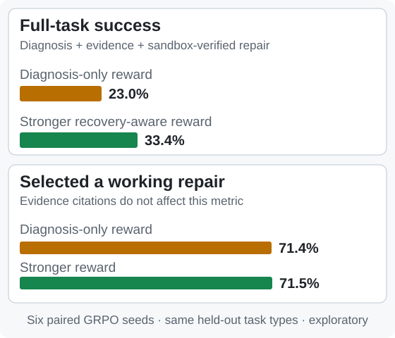

# TrainDoctor

**An executable RL environment for diagnosing and repairing failed distributed PyTorch training jobs.**

A training job can stop crashing and still be wrong: it may silently skip data, duplicate updates, restore the wrong optimizer state, or drop a worker. TrainDoctor gives an AI agent a **real multi-process PyTorch/Gloo failure**, lets it inspect evidence and propose a code/config repair, then checks whether the repaired computation is correct.

**The engineering contribution is the recovery verifier—not gVisor.** TrainDoctor uses Modal's existing gVisor sandbox to run agent-edited code. TrainDoctor adds a multi-rank failure/restart harness, a launcher-owned data server and checkpoint ledger, and **independent verification of the training state**.

> **Research preview v0.1.** Two synthetic failure families, exploratory model results, and no independent security audit. This is neither a new RL algorithm nor a general-purpose verifier for arbitrary production training code.

[Quickstart](#try-a-real-failure-on-a-cpu) · [Docs index](docs/README.md) · [Architecture](ARCHITECTURE.md)

## A successful job is not necessarily a repaired job

In one task, rank 2 calls `broadcast` while the other three ranks call `all_reduce`. Every process eventually times out. The agent can identify the mismatched operation from the per-rank trace and repair it. [See the illustrated failure](docs/figures/fig_failure.svg).

A tempting shortcut is to change `world_size` from **4 to 1**: no peers, no collective hang. **The job completes, but its training is incorrect.**

| Patch in the sandboxed A1 example | Job completes? | What TrainDoctor checks |
| --- | --- | --- |
| Make every rank use the correct collective | Yes | **Accept:** correct workers, samples, and model state |
| Reduce `world_size: 4 → 1` (fake repair F11) | Yes | **Reject:** wrong worker count, 72 missing and 8 duplicated samples, incorrect parameters |

Those figures come from the **sandboxed A1_src red-team case**, not the separate local quickstart (which uses a different seed). [Inspect the case-by-case evidence](evidence/results/REDTEAM_TABLE.md).

## How TrainDoctor verifies recovery

**Isolating a patch is different from verifying its result.** The training process can write misleading logs and even fabricate checkpoints. TrainDoctor therefore keeps a separate execution record and checks it against a known-correct, fault-free run.


*The launcher and data server are privileged **relative to the untrusted rank processes**, but remain **inside the sandbox**. The verifier is outside. Captured checkpoint contents are still treated as data to validate—not inherently trustworthy proof.*

| Implemented component | Why it matters | Code |
| --- | --- | --- |
| **Trusted data delivery** | Supplies rank-specific, salted batches over private sockets; accounts for samples independently of job-written logs. Delivery by itself does **not** prove the sample entered a committed update. | [`jobs/dataserver.py`](jobs/dataserver.py) |
| **Controlled failures and restarts** | Coordinates worker termination at step boundaries; records rank/process history and bounds work redone after recovery. | [`jobs/launcher.py`](jobs/launcher.py) |
| **Protected checkpoint capture** | Copies checkpoints at commit boundaries into launcher-owned storage, with a run ledger. Their contents still have to pass verification. | [`jobs/trusted.py`](jobs/trusted.py) |
| **Independent state checks** | Compares actual versus reference samples and checkpoints; reconstructs expected SGD/momentum updates from the batches delivered to ranks. | [`traindoctor_env/reexec.py`](traindoctor_env/reexec.py) |
| **Explicit reward components** | Reports correct diagnosis, supporting evidence, and successful verified repair separately. | [`traindoctor_env/verifiers.py`](traindoctor_env/verifiers.py) |

For the precise trust model, update rules, and limitations, see the [verifier engineering deep dive](docs/VERIFICATION.md) and [architecture map](ARCHITECTURE.md).

## What did models actually learn?

**Qwen3-4B** was evaluated on **100 held-out incidents**: these scenarios were reserved for evaluation, and the protocol was fixed before evaluating them. The table below covers the four faulted kinds, excluding the healthy-job control. Training and evaluation used different seeds but **the same fault mechanisms**.

**Full-task success (V2)** means *correct diagnosis + supporting evidence citations + a repair that passes real sandboxed execution checks*. This differs from **repair-selection accuracy**, which asks only whether the chosen repair recovers training.

| Policy | Full-task success on faulted tasks |
| --- | ---: |
| Base model | 5.0% |
| Supervised fine-tuning (SFT) on known-correct examples | 17.2% |
| Continued SFT with approximately matched learner-update compute | 29.7% |
| GRPO trained with diagnosis-only reward, mean of 6 seeds | 23.0% |
| GRPO trained with stronger recovery-aware reward, mean of 6 seeds | **33.4%** |

**The stronger reward changed evidence grounding, not repair choice.** Relative to diagnosis-only GRPO, full-task success increased by **10.36 percentage points** (95% bootstrap interval **+5.83 to +15.26**), yet both arms selected a working repair at essentially the same rate (**71.4% vs 71.5%**). The stronger arm also did **not** clearly outperform continued SFT (+3.7 points; interval −1.7 to +9.1), which was evaluated from a single checkpoint.



*How reward was computed matters:* during training, the recovery-aware arm used **precomputed exploratory repair outcomes** from a development container; it did not run a fresh trusted sandbox replay for every training response. On the held-out evaluation, **369 unique scenario/repair pairs were rerun in Modal Sandboxes** and scored separately. Results are exploratory, not evidence of generalization to unseen fault mechanisms.

[Full evaluation report and uncertainty](evidence/results/TEST_REPORT.md) · [Independent recount of available outputs](evidence/results/test/AUDIT_RECOUNT.txt) · [Six-seed development comparison](evidence/results/SEEDS_3_5_REPORT.md)

### Could incorrect repairs fool the verifier?

In the published adversarial audit, **0 of 86 attempted fake repairs were accepted**. That result needs qualification:

| Outcome | Count |
| --- | ---: |
| Rejected by a specific correctness invariant | **48** |
| Failed during execution, before usable recovery artifacts | **38** |
| Accepted fake repairs | **0** |
| Accepted known-correct reference repairs | **5/5** |
| Accepted alternative legitimate repairs | **9/10** |

The 38 execution failures **do not** demonstrate that an invariant would detect those cheats if they completed. One legitimate checkpoint-restore strategy was rejected because v1 enforced a storage format rather than equivalent recovery behavior. The attacks were created within this project, not by an external red team. The original full raw v1 JSON was lost; the [committed per-case table](evidence/results/REDTEAM_TABLE.md) is the surviving audit evidence.

[Detailed red-team figure](docs/figures/fig_redteam_funnel.svg) · [Verifier false rejection and scope](docs/VERIFICATION.md)

## Try a real failure on a CPU

Requires Python 3.12. **No GPU, API key, or Modal account** for the local demonstration. It takes roughly 30 seconds *after dependencies install*.

```bash
git clone https://github.com/TarangKhanna/traindoctor-env
cd traindoctor-env
python3.12 -m venv .venv
source .venv/bin/activate
pip install -r requirements-cpu.txt
python scripts/quickstart.py --fake F11 --out quickstart_out
```

The script runs a real four-process failing job, displays its diagnostic evidence, applies a known-correct fix and a fake fix, and shows their recovery checks. The **local result is explicitly UNVERIFIED** because modified code was run without OS-level isolation—even if the computed invariants pass. The [extended guide](docs/QUICKSTART.md) explains how to run the **trusted Modal Sandbox** path, with recorded [gold-versus-fake results](evidence/results/quickstart_verified_replay.txt).

## What remains limited

- **Task difficulty:** current tasks are easy for strong coding agents. In six development tasks, Claude Sonnet and Codex both recovered all six; Claude missed one evidence requirement. Codex also solved 24/24 attempts on eight procedurally generated tasks. These are **not useful model rankings**. [Agent comparison](experiments/cross_agent_dev6/BENCHMARK_REPORT.md) · [Task-generation pilot](experiments/mutation_pilot/README.md).
- **Reward discrimination:** each v0.1 menu has just one working repair; V1 (diagnosis + evidence) and V2 agree on 97.7% of development rollouts. More challenging repair choices are needed to test whether verification improves *repair decisions*.
- **Scope:** two synthetic families—collective mismatch / rank stall and checkpoint/sampler inconsistency. The test split is by seed, not by unseen mechanism. No claim about production NCCL/FSDP failures or arbitrary training programs.
- **Validation:** six paired GRPO seeds but only one continued-SFT run; no outside verifier audit. Held-out seed values are withheld, so the exact evaluation set cannot be regenerated solely from this repository. Executed Gloo tests require a compatible, unrestricted environment. [Test status](docs/TESTING.md) · [Evidence index](evidence/README.md).

## Explore the implementation

**RL environment and verifier engineering:** [Threat model and invariants](docs/VERIFICATION.md) · [Architecture](ARCHITECTURE.md) · [Task types](docs/TASKS.md) · [Adding a task](docs/EXTENDING.md).

**RL research:** [Reward-design findings](docs/FINDINGS.md) · [Held-out model evaluation](evidence/results/TEST_REPORT.md) · [SFT/GRPO code](modal_train/).

**Reproducibility:** [Installation and sandboxed replay](docs/QUICKSTART.md) · [Evidence index and recompute commands](evidence/README.md) · [Complete documentation index](docs/README.md).

**Terminology:** *Rank* = training worker process; *collective* = a communication operation such as `all_reduce` or `broadcast`; *reference run* = the known-correct job without the injected fault; *re-execution* = running a patched job; *independent update replay* = reconstructing expected optimizer/state updates from the known training rule.

TrainDoctor is licensed under [Apache-2.0](LICENSE) ([NOTICE](NOTICE)). Citation metadata is in [CITATION.cff](CITATION.cff). Contributions of new failure modes, valid alternative repairs, and adversarial controls are welcome; see [SECURITY.md](SECURITY.md) for security reports.
