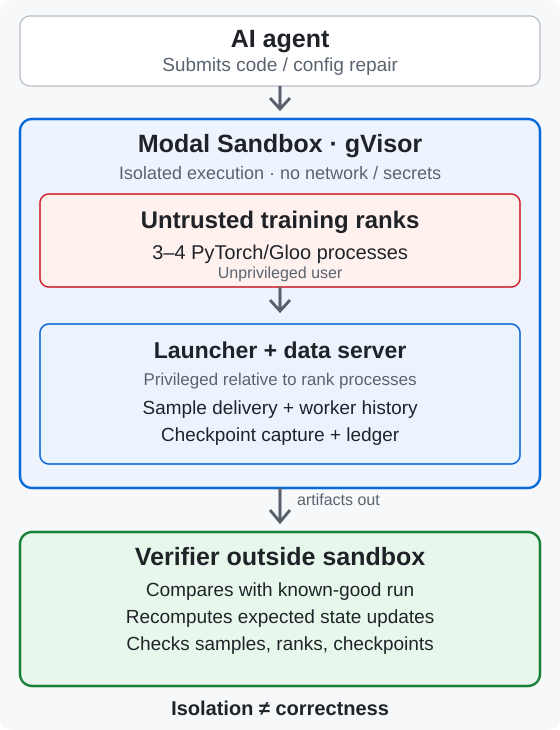

# TrainDoctor

An executable RL environment for diagnosing and repairing distributed ML training failures, with a verifier that checks whether training actually recovered.

[Quickstart](#quickstart) · [Demo](docs/DEMO.md) · [Task suite](docs/TASKS.md) · [Architecture](ARCHITECTURE.md) · [Research results](https://github.com/TarangKhanna/traindoctor-research)

TrainDoctor turns executed multi-process PyTorch (Gloo) training failures into tasks for AI agents. Agents investigate an executed failure, identify the root cause, cite evidence and repair the training job. The suite has four fault kinds across two failure families, plus a healthy-job control:

- **Distributed communication failures:** a rank enters a mismatched collective (A1), or a rank stalls before communication and never reaches the collective (A2). In both, the ranks that report a failure show the same collective timeout; in A2 the stalled rank itself is killed by the launcher watchdog.
- **Silent corruption after recovery:** a worker fails, the job restarts, loss looks normal, but checkpoint and sampler state disagree, so samples are skipped (B_SKIP) or processed twice (B_DUP).
- **Healthy control:** a job with no fault (B_OK), where the correct answer is no fault.

There are two modes over the same executed snapshot. Tier A is a single-turn bundle of evidence records and a menu of candidate repairs, used for RL training and evaluation. Tier B is an interactive development environment, not a validated multi-turn RL benchmark: tools expose logs, traces and the job's source and config, and the agent's code edits are applied and re-executed.

The central problem is verifying the repair, not detecting the failure. A job can exit cleanly with normal-looking loss and still have consumed the wrong samples or restored inconsistent optimizer state.

Code repairs are re-executed in an isolated Modal Sandbox. Launcher-controlled evidence (sample identity from a private data server, a checkpoint ledger) and an independent replay of the optimizer update let a verifier outside the sandbox check sample accounting, checkpoints, optimizer state and agreement between ranks.

Rewards have three levels: V0 (diagnosis), V1 (plus grounded evidence) and V2 (plus correctness-verified recovery).

## Why it is technically interesting

- **Executed multi-process failures:** the faults are real four-process PyTorch/Gloo jobs that hang, restart or corrupt state, not text scenarios.
- **Launcher-controlled evidence:** sample identity comes from a private-socket data server, not from logs the job writes.
- **Checkpoint capture:** the launcher copies each checkpoint into its own ledger at commit time.
- **Data accounting:** the verifier checks each scheduled sample was consumed exactly once per committed step.
- **Independent optimizer-state reconstruction:** expected SGD-with-momentum updates are replayed from the batches the data server delivered.
- **Sandboxed repair execution:** agent-edited code runs in a network-less Modal gVisor sandbox; verification happens outside it.

## Worked example: a repair that runs but is wrong

The collective mismatch below is one example, not the whole environment: the suite also covers a rank stalled before communication, checkpoint and sampler disagreement after a restart, and a healthy control.

In the A1 task, rank 2 calls `broadcast` while ranks 0, 1 and 3 call `all_reduce`, and every rank times out with the same error.


A tempting shortcut is to set `world_size` from 4 to 1 (fake repair F11). The hang disappears and the job completes, but it is no longer the same training run.

- **Quickstart scenario (seed 123):** the verifier reports the wrong worker count, 96 missing samples and parameters that differ from the reference.
- **Red-team run (task instance A1_src, replayed in a Modal sandbox):** 72 missing and 8 duplicated samples for the same fake ([per-case table](https://github.com/TarangKhanna/traindoctor-research/blob/main/evidence/results/REDTEAM_TABLE.md)). The two sets of counts come from different seeds and are not comparable.

## Where to look

- **Verifier:** [`traindoctor_env/reexec.py`](traindoctor_env/reexec.py)
- **Tier A (bundle, prompt, scoring):** [`bundle.py`](traindoctor_env/bundle.py), [`tiera.py`](traindoctor_env/tiera.py)
- **Tier B (tools):** [`tools.py`](traindoctor_env/tools.py)
- **Launcher, data server, checkpoint capture:** [`jobs/`](jobs/)
- **Design:** [ARCHITECTURE.md](ARCHITECTURE.md) and [docs/VERIFICATION.md](docs/VERIFICATION.md)

Research preview (v0.1): executable CPU/Gloo workloads with two synthetic failure families. It is not a general-purpose verifier for arbitrary production training jobs. This repository is the environment and verifier; training and evaluation results are in [traindoctor-research](https://github.com/TarangKhanna/traindoctor-research).

## Quickstart

CPU only, Python 3.12 or 3.13, no GPU, API key or Modal account.

```bash
git clone https://github.com/TarangKhanna/traindoctor-env
cd traindoctor-env
python3 -m venv .venv && source .venv/bin/activate
pip install -r requirements-cpu.txt
python scripts/quickstart.py --fake F11 --out quickstart_out
```

This builds a failed four-process job, applies the reference repair and the `world_size: 1` fake, and runs the recovery checks on both (about 30 seconds after installation). The local run prints `INVALID: unsandboxed re-execution` by design: the verifier does not count results from agent-edited code that ran without isolation. The verified path uses a Modal Sandbox ([docs/QUICKSTART.md](docs/QUICKSTART.md)). To use the package from another project: `pip install ".[modal]"` from a clone.

## How recovery verification works



Modal's gVisor sandbox isolates the agent's code but says nothing about whether the result is correct. That is the verifier's job.

Inside the sandbox, the launcher runs as root and the ranks as an unprivileged user. The launcher injects the worker failure, serves batches through a private-socket data server (sample identity comes from the socket, not from the job) and copies each checkpoint into its own ledger at commit time. The verifier runs outside and treats everything copied out as data. At each committed step it checks:

- each scheduled sample was consumed once;
- model, optimizer momentum and sampler position match the uninterrupted reference;
- where a repair changes the checkpoint layout, each transition between committed states matches an independent replay of the SGD-with-momentum update on the batches the data server delivered;
- lost work stays within one checkpoint interval, ranks agree, and protected files are untouched.

The checks are specific to this small MLP, sampler and optimizer, not a general verifier for production code. Details: [docs/VERIFICATION.md](docs/VERIFICATION.md), [ARCHITECTURE.md](ARCHITECTURE.md).

## Tasks

| Kind | Failure |
| --- | --- |
| A1 | A rank takes a different collective; every rank reports the timeout |
| A2 | One rank stalls before communication and is killed by the watchdog; its peers report the timeout |
| B_SKIP, B_DUP | After a worker failure and restart, checkpoint and sampler disagree and samples are skipped or counted twice |
| B_OK | Healthy job; the correct answer is no fault |

The ranks that report A1 and A2 failures show the same timeout, but the Tier A process records show a watchdog-killed rank only in A2, so process status alone separates A2 from A1 (a post-hoc audit on 120 new development seeds, [report](results/status_audit/run1/REPORT.md)). It cannot separate A1_src from A1_cfg. See [docs/TASKS.md](docs/TASKS.md) and [docs/EXTENDING.md](docs/EXTENDING.md).

## Tier A interface and rewards

Tier A is the single-turn form of the environment. `traindoctor_env.bundle.make_bundle` turns an executed snapshot into a compact text of evidence-id-tagged records plus a menu of repairs, capped at 3,072 Qwen3 tokens. `traindoctor_env.tiera` renders the chat prompt, parses the JSON answer (label, cited evidence ids, repair, whether it claims to have fixed the job) and scores it. Tier B is multi-turn: tools in `traindoctor_env/tools.py` expose the same snapshot and the agent edits the job's declared editable files, with the diff replay-verified.

The reward has three levels, each adding one requirement: V0 (correct diagnosis), V1 (plus cited evidence that was observed and is diagnostic for the mechanism), V2 (plus a repair that passes sandboxed re-execution, and no destructive action). A format violation scores zero. `audit/menu_leak.py` checks that the bundle and menu do not leak the label.

## Results

Qwen3-4B was trained (LoRA SFT, then GRPO) on Modal cloud GPUs and evaluated in this environment, and the verifier was attacked. Claude Sonnet and Codex were evaluated separately as existing coding agents; they were not trained here. All results are exploratory and are not reproduced by this repository, which has no training or evaluation code and withholds the held-out seeds. Statistics, uncertainty and provenance are in the research repository's [evidence map](https://github.com/TarangKhanna/traindoctor-research/blob/main/docs/EVIDENCE_MAP.md) and [erratum](https://github.com/TarangKhanna/traindoctor-research/blob/main/docs/ERRATUM_mmd.md).

- **Reward comparison:** on a held-out evaluation set, the V2 arm (recovery-aware reward) scored 10.36 points above the V0 arm (diagnosis-only reward), but the gain came from evidence grounding, not repair selection.
- **Against continued SFT:** a single run with similar compute scored 29.7%; the V2 arm's +3.7-point difference is not clearly nonzero (95% interval -1.7 to +9.1).
- **Development split:** V2 minus V0 was +4.64 points (interval -0.69 to +9.98), which is inconclusive; the minimum meaningful difference (7.2 in the frozen protocol, 20 in its amendment) was never reconciled.
- **Verifier attacks:** none of 86 fake repairs was accepted, though 38 failed during execution rather than being caught by an invariant, and I wrote the attacks.
- **Coding agents:** Claude Sonnet and Codex, evaluated separately from the Qwen3-4B results, both recovered all six development tasks (strict scores: Claude 5/6 for one missing evidence record, Codex 6/6), so the tasks are easy and do not rank agents.

## Limitations

- Two synthetic task families; splits differ by seed, not by failure mechanism.
- Each repair menu has one recovering option, so V1 and V2 agree on 97.7% of development rollouts. The results do not show that recovery-based reward improves repair selection.
- The training result rests on six paired seeds, the minimum for a consistency check rather than statistical power, and is exploratory.
- Verified replay needs a Modal account. The macOS `sandbox-exec` profile is a development convenience, not a security boundary.
- Process-status records in the Tier A bundle identify A2 against A1 perfectly (40 of 40 each) but not A1_src against A1_cfg, so a model can use that shortcut instead of the traces. The environment was not changed.
- Tier B has not been validated as a multi-turn RL benchmark.
- No claim about production NCCL/FSDP failures or arbitrary training programs.

## Documentation

Guides are in [docs/](docs/README.md). Issues and pull requests are welcome, especially new red-team cases and tasks with several plausible repairs. Security reports: [SECURITY.md](SECURITY.md).

Apache-2.0 ([LICENSE](LICENSE), [NOTICE](NOTICE)). Citation: [CITATION.cff](CITATION.cff).
