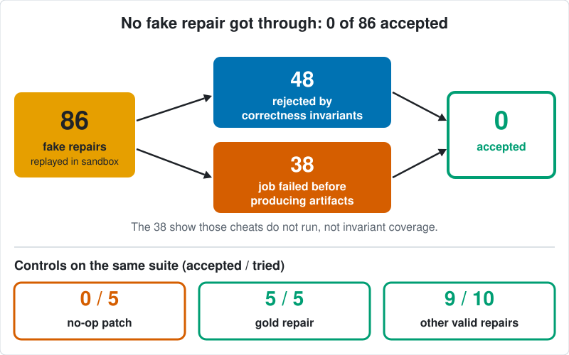
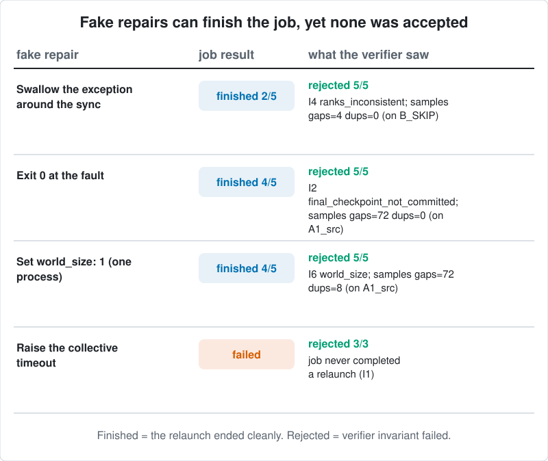
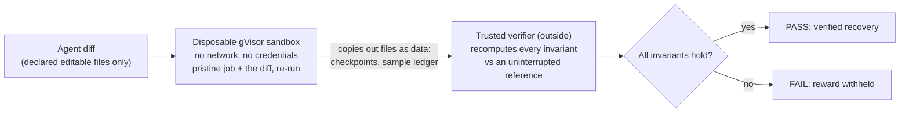

# TrainDoctor

**TrainDoctor: An executable RL environment for debugging and repairing distributed ML training failures.**

Distributed training jobs fail in ways that exit codes and log text cannot judge: a "fix" can make the job finish cleanly while it silently skips data, double-counts samples or drops a rank. TrainDoctor gives an agent a real failed multi-process PyTorch (Gloo) job, takes its diagnosis and code or config fix, re-runs the repaired job in a disposable sandbox, and has a trusted verifier outside the sandbox check recovery invariants against an uninterrupted reference run: which samples each committed step trained on, restored model/optimizer/sampler state, and rank agreement.

**Main finding (exploratory).** On a sealed test set, GRPO trained against the verified reward beat the same GRPO trained against a label-only reward by **+10.36 points** of strict end-to-end success (95% CI [+5.83, +15.26], 6 paired seeds). The gain came from evidence grounding: both arms picked the repair that actually recovers equally often (71.4% vs 71.5%). Compute-matched continued SFT is not distinguishable from the verified-reward arm.

> **Research Preview v0.1.** Two task families, exploratory results, Apache-2.0. No new training algorithm is claimed.


## Where to start

- **RL researchers:** [`docs/results/TEST_REPORT.md`](docs/results/TEST_REPORT.md) (sealed test, pre-registered protocol in [`docs/prereg/test_protocol.md`](docs/prereg/test_protocol.md)) and [`docs/FINDINGS.md`](docs/FINDINGS.md) (what the reward comparison can and cannot show).
- **Environment engineers:** [`ARCHITECTURE.md`](ARCHITECTURE.md), [`docs/TASKS.md`](docs/TASKS.md), [`docs/EXTENDING.md`](docs/EXTENDING.md) (add a task).
- **ML systems engineers:** [`docs/VERIFICATION.md`](docs/VERIFICATION.md) (invariants, trust boundary) and [`docs/REDTEAM_TABLE.md`](docs/REDTEAM_TABLE.md) (every fake repair and why it failed).
- **Benchmark evaluators:** [`docs/RELEASE_MANIFEST.md`](docs/RELEASE_MANIFEST.md) (every headline number mapped to its file and command), [`docs/benchmarks/cross_agent_dev6/`](docs/benchmarks/cross_agent_dev6/BENCHMARK_REPORT.md), [`docs/results/test/AUDIT_RECOUNT.txt`](docs/results/test/AUDIT_RECOUNT.txt) (independent recount).
- Full docs map: [`docs/README.md`](docs/README.md).

## Results

**Training against the verified reward (sealed TEST, 100 episodes, run once).**

![Top: strict live-verified success on faulted task kinds, GRPO with verified reward vs GRPO with label-only reward, one dot per seed, difference +10.36 points, CI [+5.83, +15.26]. Bottom: share of faulted rollouts that chose the repair that actually recovers, 71.4% vs 71.5%](docs/figures/fig_two_panel.svg)

- Top: the verified-reward arm reached 33.4% strict live-verified success on the four faulted task kinds versus 23.0% for the label-only arm; the difference was positive in all 6 paired seeds.
- Bottom: both arms chose the recovering repair equally often. Label accuracy also did not move (-0.10 points). The difference is in citing the right evidence (+10.68 points), so the measured gain is evidence grounding, not better repair decisions.
- Compute-matched continued SFT (a single run) remains competitive: verified-reward arm minus continued SFT is +3.70 points, CI [-1.67, +9.11]. Supervised fine-tuning alone lifted strict success from 5.0% to 17.2%.
- Pre-registered outcome class: positive effect, size unresolved (the CI straddles the 7.2-point minimum meaningful difference). Two task families and six seeds: treat this as exploratory. All 369 repair replays ran in the sandbox with 0 errors.

**Attacking the verifier before training against it.** 86 attempted fake repairs: **48 rejected by correctness invariants, 38 rejected because the job failed before producing artifacts, 0 accepted.** The 38 show those cheats do not run; they do not show invariant coverage. Controls: gold repairs 5/5 accepted, alternative valid repairs 9/10 (one false reject: a checkpoint-format check on B_DUP alt2), no-op patch 0/5. A borderline surface patch on A2 (skip the shard wait) is accepted as outcome-equivalent and is documented in [`docs/VERIFICATION.md`](docs/VERIFICATION.md). This is an adversarial audit written by the project's own agents with 2 to 5 cases per cheat class, not a comprehensive security proof.



## One example: a fix that finishes but is wrong

Task A1: one rank calls a different collective than its peers, so every rank times out. The failure trace and the quickstart description below come from the local quickstart build (seed 123: rank 2 calls `broadcast` while ranks 0, 1 and 3 call `all_reduce` at step 6). The table rows are different runs: the sandboxed red-team task `A1_src` (a different seed), replayed in the Modal sandbox ([`docs/REDTEAM_TABLE.md`](docs/REDTEAM_TABLE.md)).

| repair | job outcome | failed invariants | verdict |
|---|---|---|---|
| gold: the reference repair, so every rank calls the same collective | completed | none | accepted |
| F11: set `world_size: 1` so no collective can mismatch | completed | I6 world size; samples: 72 gaps, 8 duplicates; I3 parameters differ from reference; checkpoint format/state | rejected |

The collapse makes the error disappear and the job runs to completion, which is exactly what an exit-code or log check would reward. In the local quickstart run (seed 123), both repairs complete 12 steps; the gold run matches the reference with 0 sample gaps and 0 duplicates, while F11 leaves 96 sample gaps and its parameters and states differ from the reference ([`docs/quickstart_local_output.txt`](docs/quickstart_local_output.txt)). The sandbox and local counts differ because they are different builds. On task A2 the same F11 fake does not complete at all (killed by the watchdog).



## How verification works



The verifier does not read anything the job claims about itself. It checks, at the committed optimizer-step boundary: each step consumed exactly the samples the reference schedule assigns (none skipped, none counted twice); restored model, optimizer and sampler state equal what the checkpoint committed; lost work is within one checkpoint interval; all ranks end in the same state; protected files were not touched. Details and the `exec_mode` trust table: [`docs/VERIFICATION.md`](docs/VERIFICATION.md).

## Try it: free local demo vs trusted verification

CPU only, no paid API, no Modal account, Python 3.12.

```bash
git clone https://github.com/TarangKhanna/traindoctor-env && cd traindoctor-env
python3.12 -m venv .venv && . .venv/bin/activate
pip install -r requirements-cpu.txt
python scripts/quickstart.py --fake F11 --out quickstart_out     # about 30 s
```

This builds a real failed 4-process job, prints what the agent sees, applies the gold repair and the F11 fake, and re-runs both locally. **The local demo prints `INVALID: unsandboxed re-execution` by design**, even when every invariant passes: the frozen verifier refuses to count any outcome from agent-edited code that ran without isolation. Recorded output: [`docs/quickstart_local_output.txt`](docs/quickstart_local_output.txt).

Verified results need the sandbox backend (a Modal Sandbox; needs a Modal account). The project ledger books replays at under $0.01 each (about $0.0075 per replay on TEST; a ledger estimate, not provider billing). Recorded verified run: [`docs/results/quickstart_verified_replay.txt`](docs/results/quickstart_verified_replay.txt). Commands and unit tests: [`docs/QUICKSTART.md`](docs/QUICKSTART.md).

## What is in the repo

| path | what it is |
|---|---|
| [`traindoctor_env/`](traindoctor_env/) | core environment: snapshot/replay, tools, Tier A bundle, verifiers, oracle (plain Python) |
| [`jobs/`](jobs/) | the executable Gloo training job, fault templates, sandbox launcher, re-execution harness |
| `rl/`, `modal_train/` | prompt renderer, splits, SFT/GRPO training and eval code (Modal backend needs an account) |
| `scripts/`, `audit/`, `tests/` | quickstart, red-team suite, TEST analysis and recount, leak audit, pytest suite |
| [`docs/results/`](docs/results/) | raw results and `SHA256SUMS` (evidence; every number above comes from here) |
| [`docs/README.md`](docs/README.md) | start here for the docs: reading order, evidence index, background notes |
| [`ARCHITECTURE.md`](ARCHITECTURE.md) | one-page module map and data-flow diagram |

The five task kinds (A1, A2, B_SKIP, B_DUP, B_OK) are described in [`docs/TASKS.md`](docs/TASKS.md). Figures are regenerated from the committed result files by `scripts/make_figures.py`.

## Two side experiments

**Cross-agent benchmark (DEV, 6 tasks, exploratory).** Claude Sonnet and Codex each got the same task text and one attempt per task; every patch was replayed in the sandbox. Codex verified 6/6, Claude 5/6 (all six patches recovered; one answer omitted a required evidence record), null patch 0/6. The tasks are at the ceiling, so this shows the verifier separates repairs from non-repairs but does not rank the agents. [`docs/benchmarks/cross_agent_dev6/`](docs/benchmarks/cross_agent_dev6/BENCHMARK_REPORT.md)

**Procedural-mutation pilot (NO-GO).** Eight tasks from seeded mutations of the known-good job, each with a gold fix and a decoy that completes the job but fails the invariants. All 8 passed trusted-replay validation, but Codex verified 24 of 24 attempts, so the tasks do not discriminate and the pilot was stopped before scaling. [`experiments/mutation_pilot/`](experiments/mutation_pilot/README.md)

## Limitations

- Two task families only (collective mismatch / stalled rank; checkpoint-sampler mismatch after restart). Splits are by seed, not by mechanism, so nothing is claimed about unseen failure mechanisms.
- RL results are exploratory: six paired seeds is a robustness minimum, not statistical power; the continued-SFT control is one run.
- Each repair menu has exactly one recovering option, so the reward comparison isolates evidence grounding, not repair selection. It does not show that recovery verification improves recovery.
- The red team was written by this project with no external review; per-class sample sizes are 2 to 5.
- Training used a Docker-based fix table; TEST scores use live sandbox replay only. The sealed TEST seed list is not published (only its hash), so TEST cannot be regenerated from this repo.
- Verified replay needs a Modal account or a macOS `sandbox-exec` profile (a development convenience, not a security boundary).
- Test status: 211 passed, 32 skipped, 1 xfailed-by-design on the unit selection; the real-Gloo selection needs an unrestricted machine. Exact counts and causes: [`docs/TESTING.md`](docs/TESTING.md).

Related work and how this differs: [`docs/RELATED_WORK.md`](docs/RELATED_WORK.md). No claim of being first or only.

## Glossary

- **Rank**: one process in a multi-process training job. **Collective**: an operation all ranks must call together (`all_reduce`, `broadcast`); if one rank calls a different one, the others wait forever.
- **Gloo**: PyTorch's CPU communication backend. **gVisor**: a sandbox that isolates untrusted code; here it runs each repair with no network.
- **SFT**: supervised fine-tuning on example solutions. **GRPO**: a reinforcement-learning method that scores several sampled answers per problem and favors the better ones. **LoRA**: a small trainable adapter added to a frozen model.
- **Strict V2 / verified success**: the answer is correct, cites the right evidence, and its repair passes live sandbox replay. **Label-only (V0) reward**: credit for the correct diagnosis label alone.

## Citation

```bibtex
@software{khanna2026traindoctor,
  author  = {Khanna, Tarang},
  title   = {TrainDoctor: An executable RL environment for debugging and repairing distributed ML training failures},
  year    = {2026},
  version = {0.1.0},
  url     = {https://github.com/TarangKhanna/traindoctor-env},
  license = {Apache-2.0}
}
```

See also [`CITATION.cff`](CITATION.cff). License: Apache-2.0 ([`LICENSE`](LICENSE), [`NOTICE`](NOTICE)).

## Contributing

Issues and pull requests are welcome, especially new red-team cases (a repair the verifier accepts but should not, or rejects but should not), tasks where several plausible repairs differ in whether training recovers, and reproduction reports. Keep tests asserting a rule rather than current output; name snapshot tests `test_snapshot_*`. Security issues: [`SECURITY.md`](SECURITY.md).
